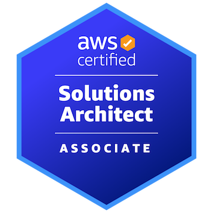
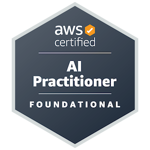
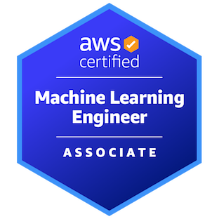
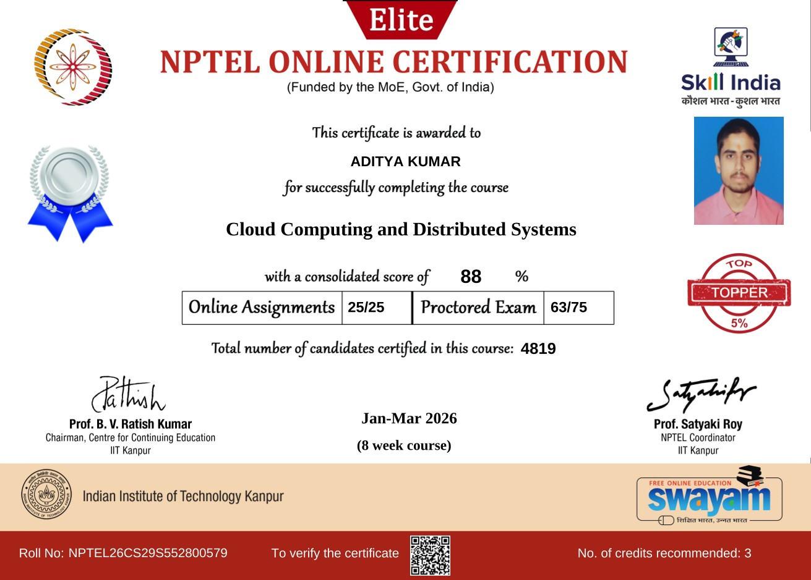
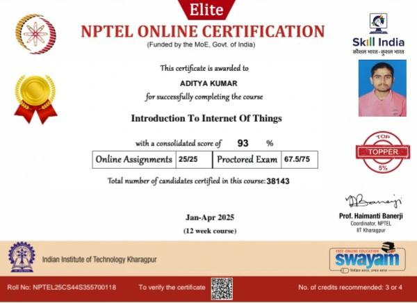

 

 

## 👨‍💻 About

I'm a B.Tech Computer Science student at **VIT Bhopal University** who builds production-ready full-stack applications with the MERN stack and explores machine learning and data pipelines. I'm an **AWS Certified Solutions Architect** and have earned two more AWS certifications in AI and machine learning.

| | |
|:--|:--|
| 🎓 **Education** | B.Tech Computer Science, VIT Bhopal University |
| 📍 **Location** | Ranchi, India 🇮🇳 |
| 🎯 **Focus** | Full-Stack (MERN) · Machine Learning · Cloud |
| 🌱 **Status** | Open to internships and collaborations |
| 🌐 **Portfolio** | [adityakumar24.vercel.app](https://adityakumar24.vercel.app/) |
| ✉️ **Contact** | [adityakumarbharadwaj@gmail.com](mailto:adityakumarbharadwaj@gmail.com) |

 

## ⚡ Tech Stack

<table>
<tr>
<td width="25%" valign="top">
<b>Frontend</b>
  

</td>
<td width="25%" valign="top">
<b>Backend & Database</b>
  

</td>
<td width="25%" valign="top">
<b>ML & Data</b>
  

</td>
<td width="25%" valign="top">
<b>Cloud & Tools</b>
  

</td>
</tr>
</table>

 

## 🚀 Featured Projects

<table>
<tr>
<td width="50%" valign="top">
<h3>🗂️ <a href="https://github.com/AdityaKumarBharadwaj/DevBoard">DevBoard</a></h3>

Project management built <i>for developers</i>: Kanban board, complexity tagging, code snippets in tasks, and sprint planning.

</td>
<td width="50%" valign="top">
<h3>🔄 <a href="https://github.com/AdityaKumarBharadwaj/SkillSwap">SkillSwap</a></h3>

Community platform where neighbors trade skills using <b>Time Credits</b> instead of money.

</td>
</tr>
<tr>
<td width="50%" valign="top">
<h3>🤝 <a href="https://github.com/AdityaKumarBharadwaj/Saahaya">Saahaya</a></h3>

NGO donation platform with Razorpay payments, auto-generated 80G tax receipts, and admin verification.

</td>
<td width="50%" valign="top">
<h3>🔧 <a href="https://github.com/AdityaKumarBharadwaj/esim-tool-manager">eSim Tool Manager</a></h3>

Python CLI that checks, installs, and manages dependencies for eSim (FOSSEE, IIT Bombay).

</td>
</tr>
</table>

 

## 🌍 Open Source Contributions

**Pull Shark** · GitHub achievement for merged pull requests.
 
<a href="https://github.com/pulls?q=is%3Apr+author%3AAdityaKumarBharadwaj+is%3Amerged+-user%3AAdityaKumarBharadwaj">View all my merged pull requests →</a>

 
 

| Project | Contribution | Pull Request | Status |
|:--------|:-------------|:-------------|:------:|
| [**InternHack-community**](https://github.com/Sachinchaurasiya360/InternHack-community) | Replaced server-side `multer` uploads with direct client-to-S3 uploads using pre-signed URLs | [**#310 →**](https://github.com/Sachinchaurasiya360/InternHack-community/pull/310) |  |
| [**OPSCORD**](https://github.com/probably-ABHINAV/OPSCORD) | Built a custom industrial-themed 404 page for the Next.js app | [**#44 →**](https://github.com/probably-ABHINAV/OPSCORD/pull/44) |  |

 

## 🏆 Certifications

<table align="center">
<tr>
<td align="center" width="33%" valign="top">

  
<b>Solutions Architect – Associate</b>
 
Issued Apr 2026 · Valid till Apr 2029
  

</td>
<td align="center" width="33%" valign="top">

  
<b>AI Practitioner</b>
 
Issued Oct 2026 · Valid till Oct 2029
  

</td>
<td align="center" width="33%" valign="top">

  
<b>Machine Learning Engineer – Associate</b>
 
Issued Oct 2026 · Valid till Oct 2029
  

</td>
</tr>
<tr>
<td align="center" colspan="3">
 
Click an AWS certificate to open its official validation page
  
</td>
</tr>
</table>

<table align="center">
<tr>
<td align="center" width="50%" valign="top">

  
<b>Cloud Computing and Distributed Systems</b>
 
NPTEL Elite · IIT Kanpur · 88% · Top 5%
</td>
<td align="center" width="50%" valign="top">

  
<b>Introduction to Internet of Things</b>
 
NPTEL Elite · IIT Kharagpur · 93% · Top 5%
</td>
</tr>
</table>

 

## 📈 GitHub Stats

&nbsp;&nbsp;

 
 

 

## 💬 Let's Connect

I'm open to internships, project collaborations, and conversations about tech or cricket. The best ways to reach me are my [portfolio](https://adityakumar24.vercel.app/), [LinkedIn](https://www.linkedin.com/in/aditya-kumar-8248a2293/), or [email](mailto:adityakumarbharadwaj@gmail.com).

